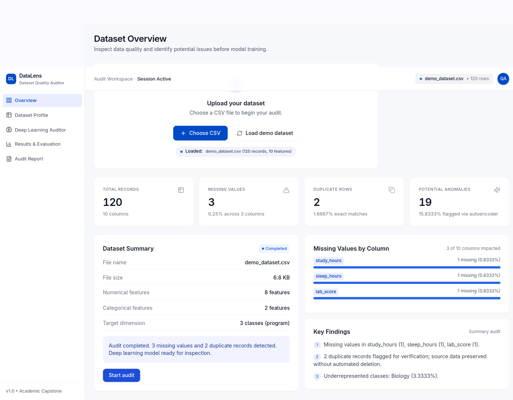
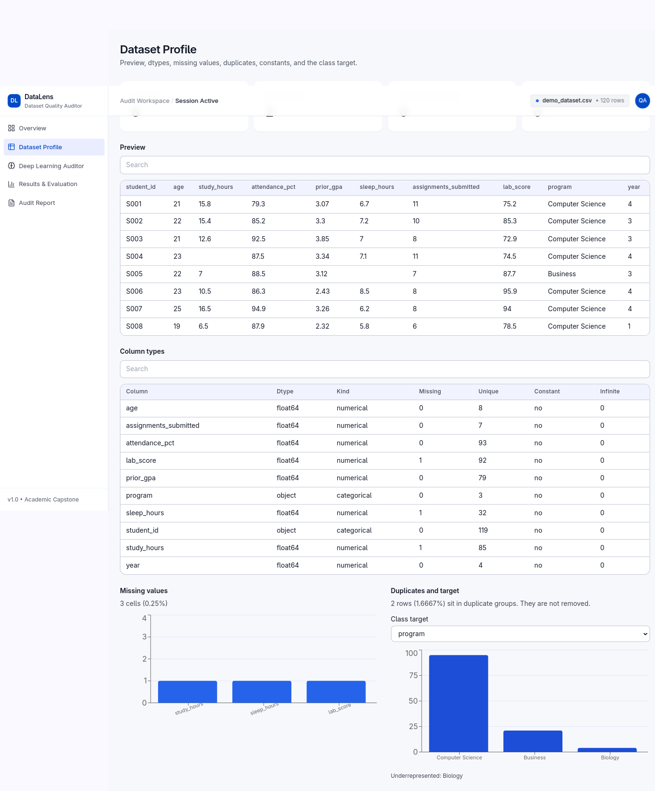
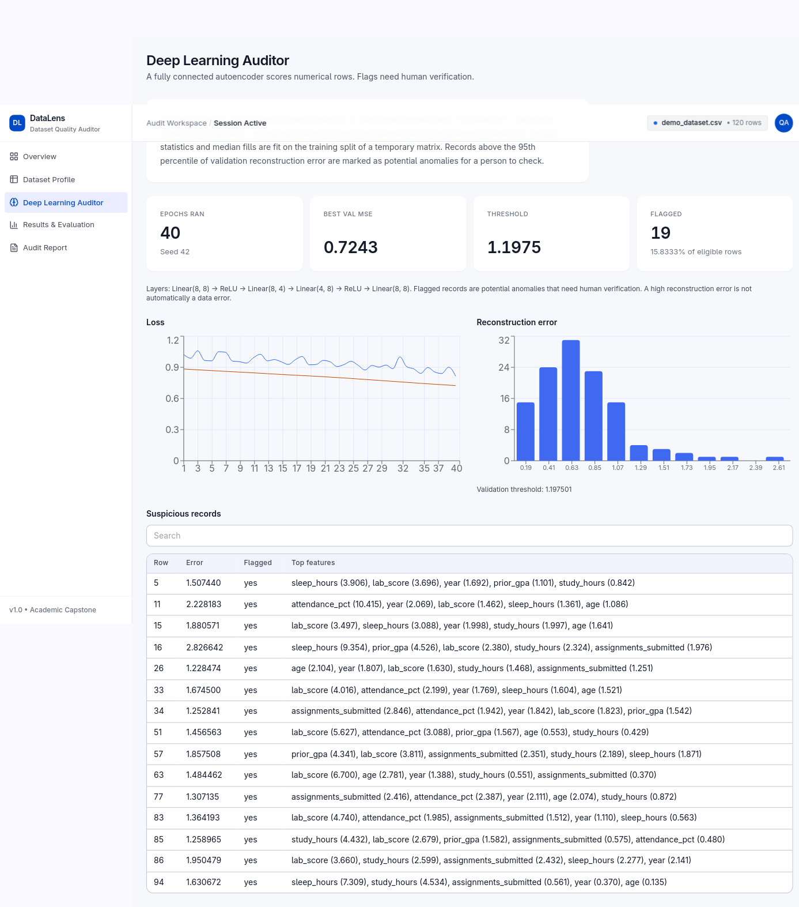
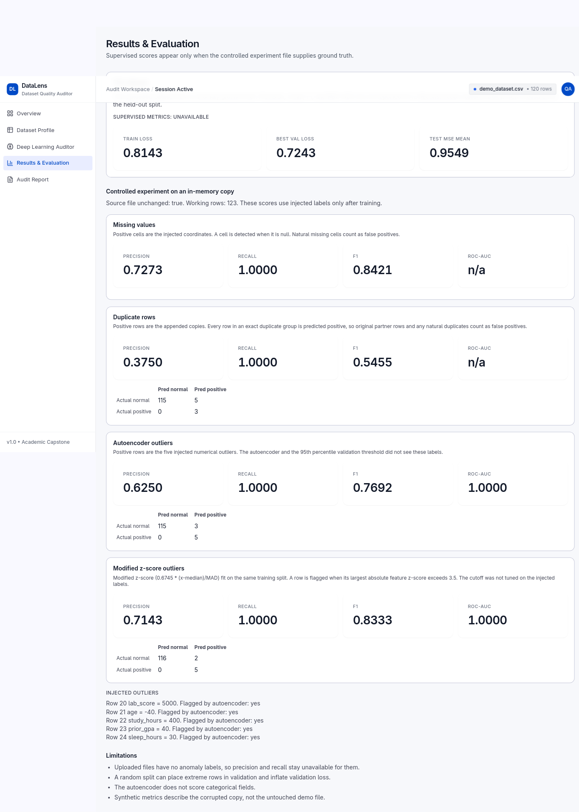
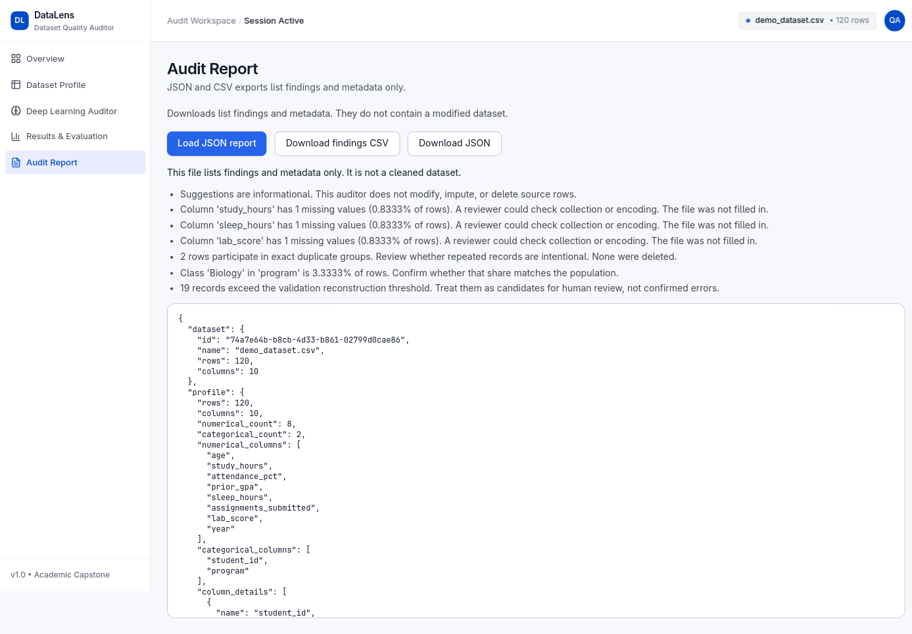
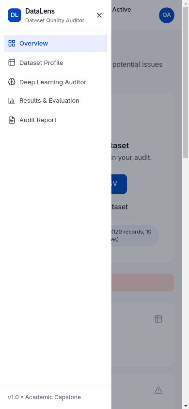

# AI Dataset Quality Auditor Using Deep Learning

A local auditor for small CSV files. It measures missing values, exact duplicate rows, class imbalance, and numerical reconstruction error with a PyTorch autoencoder, then explains the findings in a five-page dashboard.

**Audit only.** The app never imputes the stored table, deletes duplicates, changes labels, or exports a repaired dataset. Downloads contain findings and metadata only. A flagged row is a candidate for human review, not a confirmed error.

Open the interface at http://localhost:5173, the API at http://localhost:8000, and the API docs at http://localhost:8000/docs.

## Screenshots

These frames are from a real demo audit of `demo_dataset.csv` in the running app (120 rows, 3 missing cells, 2 duplicate rows, 19 reconstruction flags).

### Overview



*Overview after Load demo dataset and Start audit.*

### Dataset Profile



*Profile preview, dtypes, missing-value chart, and the program class chart.*

### Deep Learning Auditor



*Loss curve, error histogram, threshold 1.1975, and feature contributions.*

### Results and Evaluation



*Held-out reconstruction stats and the controlled-experiment scores.*

### Audit Report



*Findings list and JSON export. The file is not a cleaned dataset.*

### Mobile navigation



*At a narrow width the sidebar collapses and the menu lists all five pages.*

## Stack

- Frontend: React, Vite, JavaScript, Tailwind CSS, Recharts, Axios, Lucide React
- Backend: Python, FastAPI, Uvicorn, Pandas, NumPy, Pydantic
- Model: a small fully connected PyTorch autoencoder (MSE, Adam) on CPU
- Tests: pytest and scikit-learn

No database, login, paid API, or GPU is required. Normal use does not need the internet after the packages are installed.

## Clone this branch

```bash
git clone -b cursor/dataset-quality-auditor-448c https://github.com/devvvv100707/dataset-quality-auditor.git
cd dataset-quality-auditor
```

## Setup and run (Apple Silicon MacBook Air)

Use two terminals. Python 3.11+ is enough. These commands were written for macOS.

### Backend (port 8000)

```bash
python3 -m venv .venv
source .venv/bin/activate
pip install -r backend/requirements.txt
cd backend
uvicorn main:app --host 127.0.0.1 --port 8000
```

Leave that terminal running. Open http://localhost:8000/docs to see the routes.

### Frontend (port 5173)

```bash
cd frontend
npm install
npm run dev
```

Vite serves http://localhost:5173 and calls the API at http://localhost:8000.

### Experiment and tests

From `backend/`, with the virtual environment activated:

```bash
source ../.venv/bin/activate
python experiments/run_experiments.py
pytest
```

`run_experiments.py` corrupts an **in-memory copy** of the demo CSV and writes `backend/reports/experiment_results.json`. It does not edit `backend/data/demo_dataset.csv`.

### Stop the servers

In each terminal, press `Ctrl+C`.

## Autoencoder

For a dataset whose usable numerical columns number `n`, the network is:

`Linear(n, 8) → ReLU → Linear(8, 4) → Linear(4, 8) → ReLU → Linear(8, n)`

The hidden sizes are `(8, 4)`. The bottleneck is 4. The demo file has 8 usable numerical inputs (`age`, `study_hours`, `attendance_pct`, `prior_gpa`, `sleep_hours`, `assignments_submitted`, `lab_score`, `year`), so the trained net is `Linear(8, 8) → ReLU → Linear(8, 4) → Linear(4, 8) → ReLU → Linear(8, 8)`.

- Loss: mean squared error
- Optimizer: Adam, learning rate `0.001`
- Seed: `42`
- Maximum epochs: `40`, early stopping patience `6`
- Split when there are at least 30 eligible rows: 60% train, 20% validation, 20% test
- Median fill and standardization are fit on the **training split only**, inside a temporary matrix. The uploaded table is not changed.
- A row is flagged when its reconstruction MSE is above the **95th percentile of validation reconstruction errors**. Anomaly labels are not used to train the model or to pick that threshold.
- Each dataset gets its own model under `backend/models/<dataset-id>/`.

If there is no usable numerical column, or fewer than 30 eligible rows, training is skipped and the API returns that limitation instead of made-up scores.

## Demo dataset

`backend/data/demo_dataset.csv` is bundled so the app works offline.

- 120 rows, 10 columns: `student_id`, `age`, `study_hours`, `attendance_pct`, `prior_gpa`, `sleep_hours`, `assignments_submitted`, `lab_score`, `program`, `year`
- 3 natural missing cells, one repeated row (2 rows in a duplicate group), and an underrepresented `Biology` class (4 of 120 rows, 3.3333%)
- SHA-256 recorded by the experiment, before and after: `9dcc13988492b6a50a75d770328ccdb47bca749ef05636d68f41f0c8b6283c22` (`source_unchanged: true`)

Optional larger files, not required: the UCI Adult (Census Income) dataset, https://archive.ics.uci.edu/dataset/2/adult, and Bank Marketing, https://archive.ics.uci.edu/dataset/222/bank+marketing. Convert one to CSV yourself and upload it. The app does not download them.

## How to use the five pages

1. **Overview.** Choose a CSV (UTF-8, up to 2 MB, at most 20,000 rows and 80 columns) or click **Load demo dataset**. Then click **Start audit**. Cards show row count, missing cells, duplicate rows, and autoencoder flags only after those steps have run. See [docs/images/overview.png](docs/images/overview.png).
2. **Dataset Profile.** Preview, dtypes, missing chart, duplicate count, constant columns, and a class-target dropdown. Pick `program` on the demo file to see the Biology share. Changing the target remeasures class balance and does not edit the file. See [docs/images/dataset-profile.png](docs/images/dataset-profile.png).
3. **Deep Learning Auditor.** Architecture, loss curve, reconstruction-error histogram, validation threshold, flagged count, and a searchable table of high-error rows with per-feature squared error. See [docs/images/deep-learning-auditor.png](docs/images/deep-learning-auditor.png).
4. **Results & Evaluation.** For an upload, supervised precision, recall, and F1 stay unavailable because there is no anomaly ground truth. Reconstruction stats from the held-out split are shown. The lower section reads `backend/reports/experiment_results.json` and labels those scores as a controlled experiment on a copy. See [docs/images/results-evaluation.png](docs/images/results-evaluation.png).
5. **Audit Report.** Load the JSON report, then download JSON or the findings CSV. Both list checks, model settings, suggestions, and limitations. They are not a cleaned copy of the CSV. See [docs/images/audit-report.png](docs/images/audit-report.png).

On a phone-width window the left rail is hidden until the menu button is opened ([docs/images/mobile-nav.png](docs/images/mobile-nav.png)).

## Experiment results

These numbers are copied from `backend/reports/experiment_results.json`, produced by `python experiments/run_experiments.py`. The script started from the 120-row demo file, worked on a copy with 123 rows, injected 8 missing cells, appended 3 duplicate rows, and overwrote five numeric cells (row 20 `lab_score=5000`, row 21 `age=-40`, row 22 `study_hours=400`, row 23 `prior_gpa=40`, row 24 `sleep_hours=30`). Labels were used only when scoring.

On that corrupted copy the statistical audit reported 11 missing cells (0.8943%) and 8 rows in duplicate groups (6.5041%).

The autoencoder on that copy ran 7 epochs in 0.7271669089999477 seconds (split 73 / 25 / 25). Train loss 1.0029680927594502. Best validation loss 54.66534434238061. Test reconstruction MSE mean 6.236375967458807, standard deviation 27.12949772366556, minimum 0.1275288595753607, median 0.6641319283980546, maximum 139.12832003919064. Threshold 1.7251438340344465. Flagged 8 rows (6.5041%).

| Detector | Precision | Recall | F1 | Other |
| --- | --- | --- | --- | --- |
| Missing cells | 0.7272727272727273 | 1.0 | 0.8421052631578948 | TP 8, FP 3 (the 3 natural missing cells), FN 0 |
| Appended duplicate rows | 0.375 | 1.0 | 0.5454545454545454 | TN 115, FP 5, FN 0, TP 3, FPR 0.041666666666666664 |
| Autoencoder outliers | 0.625 | 1.0 | 0.7692307692307693 | TN 115, FP 3, FN 0, TP 5, FPR 0.025423728813559324, ROC-AUC 1.0, average precision 1.0 |
| Modified z-score (cutoff 3.5, not tuned on labels) | 0.7142857142857143 | 1.0 | 0.8333333333333334 | TN 116, FP 2, FN 0, TP 5, FPR 0.01694915254237288, ROC-AUC 1.0, average precision 1.0 |

A separate audit of the **unmodified** demo file, measured in the browser against the API, is not the same run. That session trained for 40 epochs, best validation MSE 0.7243, threshold 1.1975, and flagged 19 of 120 rows (15.8333%). Supervised metrics were correctly marked unavailable.

## Tests

`pytest` in `backend/` on 10 October 2026 reported:

```text
12 passed, 1 warning in 4.37s
```

The warning is a Starlette deprecation notice inside the test client, not a failed assertion. The tests cover quality checks, training without mutating the frame, report export, and the API, including the assertion that the demo file bytes do not change.

## Methodology in brief

Statistical checks count missing cells, exact duplicate rows, column types, constants, non-finite values, and class shares. Nothing is deleted or filled in the stored table.

The autoencoder learns to reconstruct scaled numerical columns. High error means the row is unusual relative to the training split. The 95th percentile threshold comes from validation errors only.

The experiment keeps a record of every injected cell and row. Those labels are not passed into `train_autoencoder` and are not used to set the percentile. False positives against the synthetic labels include natural missing cells and the original partners of injected duplicates. More detail is in [docs/methodology.md](docs/methodology.md).

## Known limitations

- A high reconstruction error is not proof that a value is wrong.
- Categorical columns are profiled and used for class balance. They are not reconstructed.
- Constant, empty, or non-finite numerical columns are left out of the model and named in the report.
- Fewer than 30 eligible rows skips training. No metrics are invented in that case.
- On an ordinary upload there is no anomaly ground truth, so precision, recall, F1, and ROC-AUC are omitted.
- A random split can place an extreme row in validation and inflate validation loss. That happened in the controlled experiment (best validation loss 54.66534434238061).
- On these single-column injections, the modified z-score baseline F1 (0.8333333333333334) was higher than the autoencoder F1 (0.7692307692307693).
- The JSON report includes an 8-row preview inside the profile section. The findings CSV does not contain the full table. Neither file is a cleaned dataset.
- The Stitch reference designs the Overview screen. The other four pages use the same shell, type, and cards.

## Troubleshooting

- Port 5173 or 8000 already in use: stop the other process, then start again.
- `uvicorn` not found: `source .venv/bin/activate` before starting the API.
- Upload rejected: the file must be a UTF-8 `.csv` with a header, unique column names, and within the size limits above. An empty file returns `The file is empty.` A non-CSV name returns `Only .csv files are accepted.`
- The page cannot reach the API: keep uvicorn on port 8000. The allowed browser origins are `http://localhost:5173` and `http://127.0.0.1:5173`.
- Training skipped: read the limitation text on the Deep Learning Auditor page. Add numerical columns or more rows. Do not expect scores when the model did not run.
- Torch’s install is large. This project uses the CPU build.
